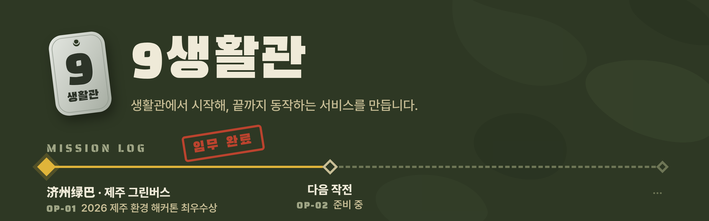
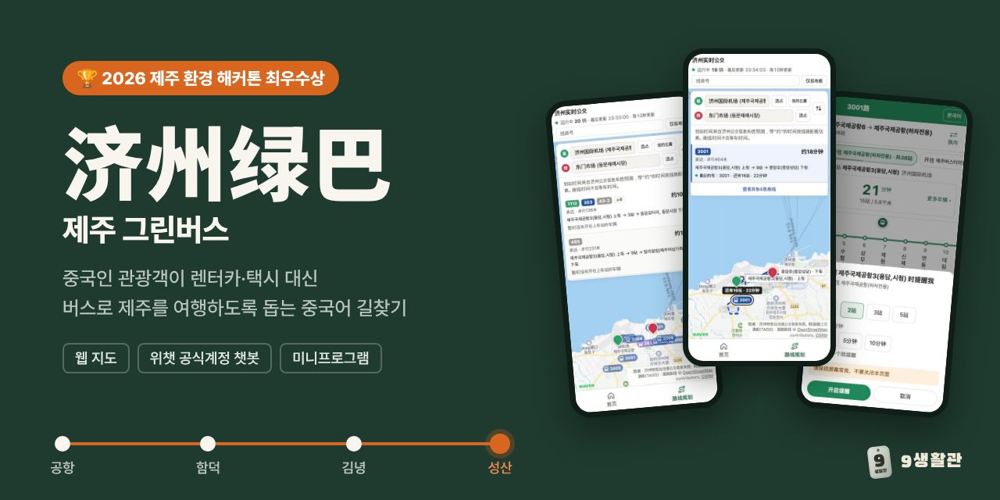

  

  <b>9생활관</b>은 군대에서 만난 선임과 후임이 꾸린 개발팀입니다. 
  문제를 데이터로 확인하고, 주어진 시간 안에 실제로 동작하는 서비스까지 만듭니다.

## 🎖️ 작전 기록

| 작전 | 프로젝트 | 결과 |
| :--: | :-- | :-- |
| `OP‑01` | **[济州绿巴 · 제주 그린버스](https://github.com/9saenghwalgwan/jeju-greenbus)** 중국인 개별 관광객이 렌터카·택시 대신 버스로 제주를 여행하도록 돕는 중국어 길찾기 서비스 웹 지도 · 위챗 공식계정 챗봇 · 위챗 미니프로그램 | 🏆 **2026 제주 환경 해커톤 최우수상** 15팀 중 · 2026.11.03 – 11.04 |
| `OP‑02` | 다음 작전 준비 중 | — |

## 🪖 대원

<table>
  <tr>
    <td align="center" width="50%">
      <a href="https://github.com/NewCodes7"> <b>김상혁</b></a> 
      @NewCodes7 
      서버 · 경로 탐색 · LLM 챗봇 · 위챗 연동 · 배포
    </td>
    <td align="center" width="50%">
      <a href="https://github.com/qonehan"> <b>한규원</b></a> 
      @qonehan 
      데이터 조사 · 위챗 챗봇 프로토타입 · 버스 접근성 분석 · 발표 자료
    </td>
  </tr>
</table>

## 🧰 장비

🪖 점호 전까지 배포 완료.

